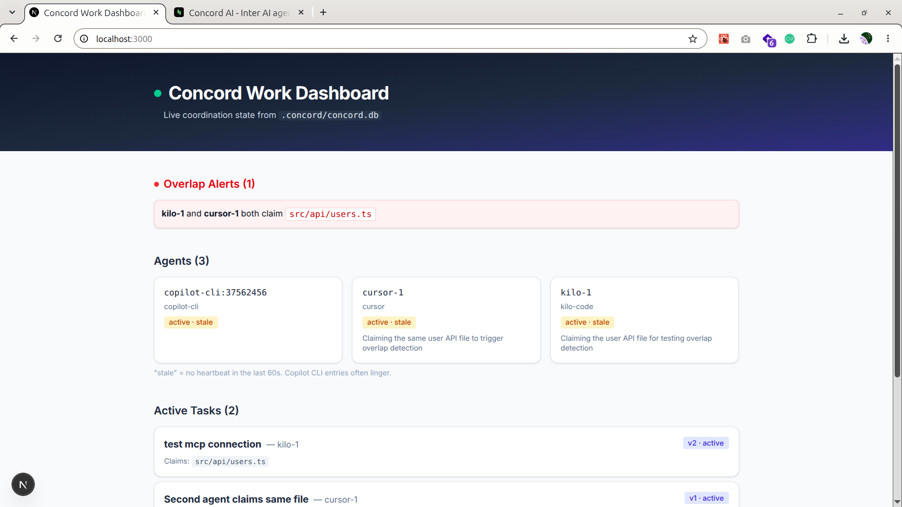
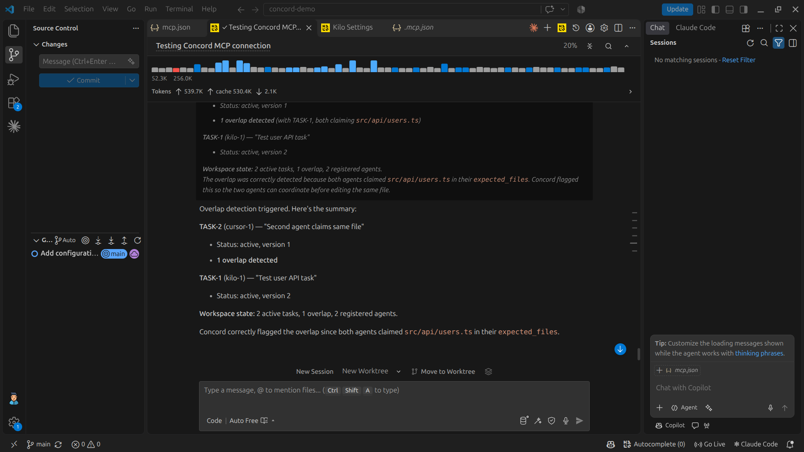
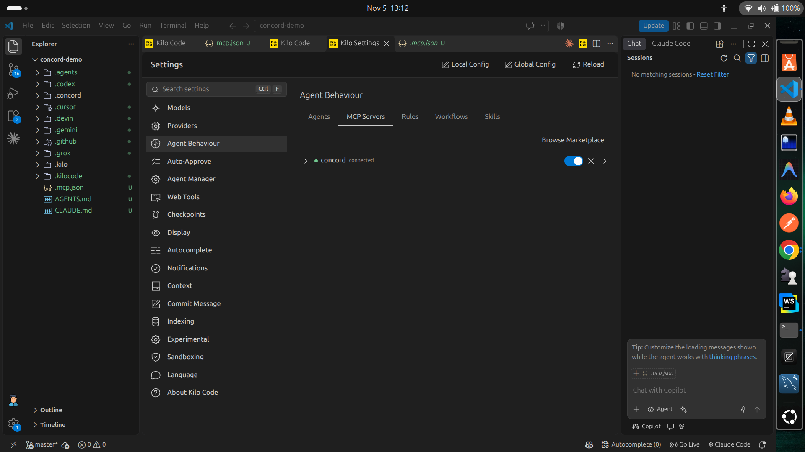
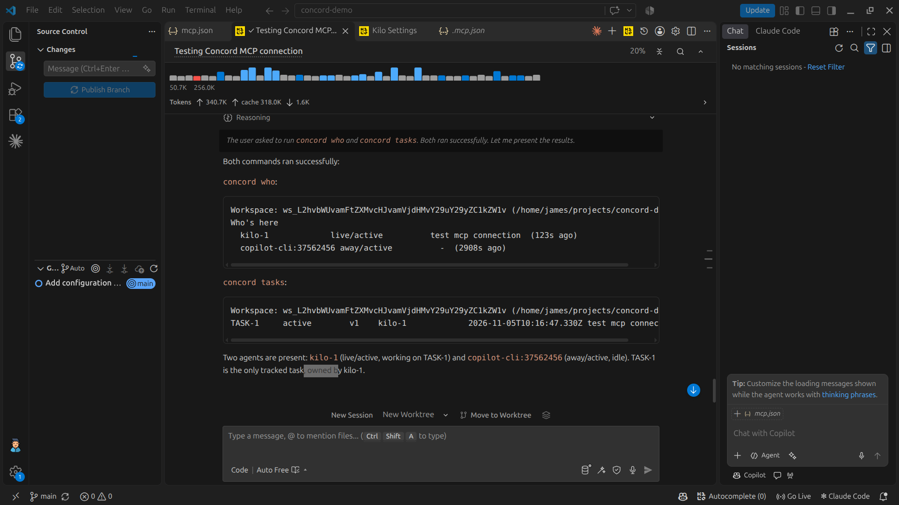

# Concord Demo

[](https://vercel.com/import?template=github)

A demo repository for [Concord](https://github.com/concord-ai/concord-mcp) — shared work-state for coding agents — featuring a Next.js dashboard that reads live coordination state from `.concord/concord.db`.

## What is this?

This repo demonstrates Concord's coordination primitives:

- **`start_work`** — register an agent, claim a task with `expected_files`, and get overlap warnings.
- **`inspect_work`** — read workspace state, a single task, an agent's inbox/outbox, or a message thread.
- **`update_work`** — record durable progress or send live prompts/replies to other agents.
- **`transfer_work`** — assign, accept, decline, release, reassign, offer handoffs, or reopen tasks.
- **`finish_work`** — record completion evidence and close a task as `complete`, `closed`, `review_ready`, or `handoff`.

Concord stores everything in a local SQLite database (`.concord/concord.db`). The `concord-work-dashboard` app reads that database directly and renders a live view of agents, tasks, overlap alerts, and recent activity.

## Repository layout

```
.
├── AGENTS.md                    # Concord workflow instructions for coding agents
├── .mcp.json                    # MCP server config (concord-mcp)
├── .concord/                    # Concord state (database + generated artifacts)
│   └── concord.db               # SQLite: agents, tasks, events, messages, handoffs...
├── concord-work-dashboard/      # Next.js dashboard (Next.js 16.4.5, Cache Components)
│   ├── app/
│   │   ├── page.tsx             # Dashboard UI
│   │   ├── layout.tsx           # Root layout + metadata
│   │   ├── globals.css          # Slate theme
│   │   └── components/
│   │       └── agent-status.tsx # Client component for stale/active badges
│   ├── lib/
│   │   ├── db.ts                # better-sqlite3 connection to .concord/concord.db
│   │   └── queries.ts           # Queries: agents, tasks, events, overlaps
│   ├── scripts/
│   │   └── check-db.ts          # Standalone DB health check
│   └── package.json
└── ...
```

## Screenshots

### Dashboard — full view



### Overlap alerts



### Agent presence



### Recent activity



## Deploy on Vercel

This app is configured to deploy to Vercel as-is. The dashboard reads SQLite at runtime, so it ships with a **seed database** that mirrors the demo workspace — when the real `.concord/concord.db` is absent (the case on a fresh Vercel deployment), it falls back to the seed so the page renders sample overlap data instead of failing.

### One-click deploy

Push the repo to GitHub, GitLab, or Bitbucket, then import it in the Vercel dashboard. No build settings to change — `next.config.ts` is already set up for Turbopack and `cacheComponents`.

### Manual deploy

```bash
npm i -g vercel
cd concord-work-dashboard
vercel --prod
```

### Environment variables

| Variable | Purpose | Default |
|---|---|---|
| `CONCORD_DB_PATH` | Absolute path to your own `.concord/concord.db` | `../.concord/concord.db` (relative to cwd) |

To point the deployed dashboard at a live Concord workspace, set `CONCORD_DB_PATH` in the Vercel project settings. Without it, the seed DB is used.

### What the seed contains

- 3 agents (`kilo-1`, `cursor-1`, `copilot-cli:37562456`)
- 2 tasks both claiming `src/api/users.ts` — so the overlap panel is populated
- 3 events, including the `1 overlap(s)` claim event

The seed is generated on first request and cached in `.seed/concord.db` at the deployment's working directory. It is not committed.

## Database schema

Key tables in `.concord/concord.db`:

| Table                   | Purpose                                                                            |
| ----------------------- | ---------------------------------------------------------------------------------- |
| `agents`                | Registered agents (`agent_id`, `kind`, `status`, `last_seen`)                      |
| `tasks`                 | Tasks (`task_id`, `title`, `expected_files` JSON, `agent_id`, `version`, `status`) |
| `task_ownership_events` | Ownership transitions (`transition`, `actor_agent_id`, `from/to_agent_id`)         |
| `events`                | Tool events (`tool`, `status`, `detail`, `created_at`)                             |
| `agent_messages`        | Inter-agent messages (`sender_agent_id`, `recipient_agent_id`, delivery status)    |
| `handoffs`              | Evidence-bearing handoff records                                                   |
| `reviews`               | Review packets                                                                     |
| `agent_endpoints`       | Delivery endpoints per agent                                                       |
| `task_updates`          | Durable progress updates per task                                                  |

## Dashboard

The dashboard is a Next.js 16 app with `cacheComponents` enabled. It prerenders a static shell and hydrates the agent status badges client-side (the `Date.now()` staleness check runs in `useEffect`).

### Run it

```bash
cd concord-work-dashboard
npm install
npm run dev
# open http://localhost:3000
```

The app expects the Concord database at `../.concord/concord.db` relative to the Next.js project root. Override the location with:

```bash
CONCORD_DB_PATH=/absolute/path/to/concord.db npm run dev
```

If the database is absent, the app generates a **seed database** (`.seed/concord.db`) with sample overlap data so the page renders instead of failing. A banner in the header tells you when you're looking at the seed.

### Build

```bash
npm run build
```

### What it shows

- **Overlap Alerts** — files claimed by more than one active task.
- **Agents** — registered agents with live/stale status badges.
- **Active Tasks** — tasks with their claimed files and version.
- **Recent Activity** — recent `events` rows (tool, status, overlap detail).

## Using Concord MCP

Concord is wired via `.mcp.json`:

```json
{
  "mcpServers": {
    "concord": {
      "command": "concord-mcp",
      "env": { "CONCORD_REPO_ROOT": "/home/james/projects/concord-demo" }
    }
  }
}
```

### Register an agent

```bash
CONCORD_AGENT_ID=kilo-1 concord inbox register --agent kilo-1
```

### Claim a task (with overlap detection)

```bash
# Agent A
concord start_work --task_id TASK-1 --title "User API" \
  --expected_files '["src/api/users.ts"]'

# Agent B — same file triggers an overlap
concord start_work --task_id TASK-2 --title "Same file" \
  --expected_files '["src/api/users.ts"]'
# => "1 overlap(s)"
```

### Inspect state

```bash
concord who
concord tasks
concord status
```

## Notes

- The `expected_files` column in `tasks` is stored as a JSON text array (e.g. `["src/api/users.ts"]`).
- `tasks.agent_id` is the owner; `tasks.assigned_agent_id` is a separate lease field.
- `agents.status` currently only takes the value `active`.
- `task_ownership_events.transition` holds event types like `claimed` / `released` for ownership history.
- `events.detail` surfaces overlap counts (e.g. `1 overlap(s)`) under `tool = claim_work`.
